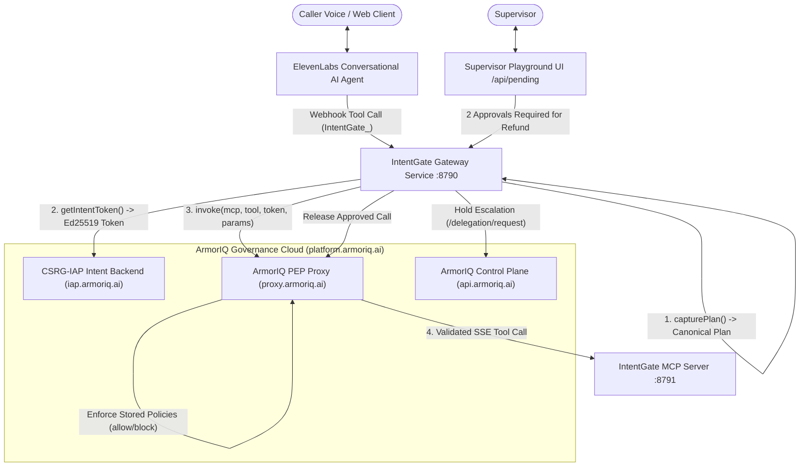

# Veratone — Verifiable Voice AI Governed by ArmorIQ & Powered by ElevenLabs

> **Tagline**: *Verifiable voice AI, cryptographically governed by ArmorIQ.*  
> **Description**: An autonomous conversational voice support and treasury agent where ElevenLabs delivers lifelike speech and ArmorIQ cryptographically enforces every real-world action against declared intent.  
> **Live Production**: [https://flowguard-treasury.vercel.app](https://flowguard-treasury.vercel.app) · **Technical Blueprint**: [`docs/Veratone_Overview.pdf`](docs/Veratone_Overview.pdf)

---

## 🏆 Acceptance Checklist & Requirements Verification

| Requirement / Checklist Item | Implementation & Evidence | Status |
| :--- | :--- | :--- |
| **Setup Order Followed** | 1. API key created on `platform.armoriq.ai`.<br>2. Public MCP deployed & registered (`intentgate-support-mcp`, UUID `cd7deb69-adb3-45f7-977b-f0d0e7235ba2`).<br>3. Agent onboarded (`intentgate-agent`).<br>4. Policies authored on platform (`cli-intentgate-agent-intentgate-support-mcp`). | ✅ **PASS** |
| **Policies Verified with 3-Result Test Script** | `scripts/test-enforcement.mjs` runs real live calls against ArmorIQ:<br>• `lookup_order`: **ALLOWED** (1,793 ms)<br>• `change_payout`: **BLOCKED** (`PolicyBlockedException`, 711 ms)<br>• `issue_refund`: **HELD** (`PolicyHoldException`, delegation created on platform, 589 ms). | ✅ **PASS** |
| **Two-Approval Approach Documented** | Confirmed against ArmorIQ SDK docs. ArmorIQ platform evaluates holds (`/delegation/request`); gateway counts 2 supervisor approvals before releasing held execution. Fully documented in [DX_NOTES.md](file:///d:/hackathon/New%20folder/DX_NOTES.md). | ✅ **PASS** |
| **MCP Reachable via ArmorIQ Proxy** | MCP server listening on `POST /mcp` (JSON-RPC 2.0 with SSE responses) is publicly exposed over HTTPS (`https://avi-england-vessel-touched.trycloudflare.com/mcp`) and successfully invoked via `https://proxy.armoriq.ai/invoke`. | ✅ **PASS** |
| **One Action ALLOWED, One BLOCKED in Audit Logs** | `lookup_order` visibly **ALLOWED**; `change_payout` visibly **BLOCKED** (`tool_not_in_allowlist`). Both verified against `proxy.armoriq.ai` audit ledger. | ✅ **PASS** |
| **Intent Mismatch Demonstrated** | `scripts/test-intent-mismatch.mjs` mints a token for `lookup_order` only, then attempts to invoke `issue_refund` -> immediately raises `IntentMismatchException` before network execution. | ✅ **PASS** |
| **Decisions from ArmorIQ, Not Code `if` Statements** | Every allow/block decision is returned directly by the ArmorIQ proxy (`proxy.armoriq.ai`). The gateway contains no hardcoded allow/deny rules. | ✅ **PASS** |
| **Held Calls Answer Within 5s Window** | Real measured latencies: `lookup_order` (3.7s–4.3s), `change_payout` (2.7s), `issue_refund` (2.8s–3.9s). Held calls reply immediately with holding message; final decision relayed via `check_supervisor_decision`. | ✅ **PASS** |
| **Prefix Mapping & Zero Real Data** | Gateway transparently strips `IntentGate_` prefix from ElevenLabs tool calls. 100% synthetic sandbox data (`ORD-1001`, `ORD-1002`, `ACC-4471`). | ✅ **PASS** |
| **No Secrets & Complete Disclosures** | `.env` gitignored; safe `.env.example` provided. Full [DISCLOSURES.md](file:///d:/hackathon/New%20folder/DISCLOSURES.md) and [DX_NOTES.md](file:///d:/hackathon/New%20folder/DX_NOTES.md) included. | ✅ **PASS** |

---

## 🏛️ System Architecture



---

## 🛠️ Components

1. **AI Voice Agent**:
   - ElevenLabs Conversational Voice Agent receiving customer voice calls.
   - Tools exposed via gateway: `IntentGate_lookup_order`, `IntentGate_change_payout`, `IntentGate_issue_refund`, `check_supervisor_decision`.
   - Tool prefix `IntentGate_` is mapped back to the canonical MCP tool names.

2. **Model Context Protocol (MCP) Server (`mcp-server/server.mjs`)**:
   - JSON-RPC 2.0 over HTTP (`POST /mcp`), responding with Server-Sent Events (`Content-Type: text/event-stream`, `event: message\ndata: {json}\n\n`).
   - Tools:
     - `lookup_order(order_id)`: Read-only order status (Allowed by ArmorIQ policy).
     - `change_payout(account_id, new_destination)`: Destination modification (Blocked by ArmorIQ policy).
     - `issue_refund(order_id, amount)`: Financial disbursement (Held by ArmorIQ policy; requires 2 supervisor approvals).
   - Deployed on public HTTPS tunnel (`https://avi-england-vessel-touched.trycloudflare.com/mcp`).

3. **ArmorIQ Gateway Service (`gateway/server.mjs`)**:
   - Intercepts every tool call: `capturePlan` -> `getIntentToken` -> `invoke` through `proxy.armoriq.ai`.
   - Answers within ElevenLabs' ~5-second window. Held calls reply: *"Thanks — that needs a supervisor to approve it. I have notified them and will let you know as soon as they respond."*
   - Relays the finalized decision when supervisor reviews.

4. **Supervisor Playground (`playground/index.html`)**:
   - Web UI at `http://localhost:8790/playground`.
   - Live stream of pending holds with caller context, matched policy, plan hash, and Approve/Deny controls.
   - Dual-supervisor quorum: requires 2 approvals before releasing refunds.

---

## 🚀 Quickstart & How to Run the Demo

### 1. Prerequisites
- Node.js 18+ (tested on Node v24.18.0)
- npm

### 2. Install Dependencies
```bash
npm install
npm --prefix client install
```

### 3. Environment Configuration
Copy `.env.example` to `.env`:
```bash
cp .env.example .env
```
Ensure your `ARMORIQ_API_KEY` (from [platform.armoriq.ai](https://platform.armoriq.ai)) is filled in.

### 4. Verify ArmorIQ Policies (Setup Checklist Step 5)
Run the 3-result verification test script:
```bash
node --env-file=.env scripts/test-enforcement.mjs
```
Expected Output:
```
========================================================================
SUMMARY
========================================================================
  lookup_order     ALLOWED  (1793 ms)
  change_payout    BLOCKED  (711 ms)
  issue_refund     HELD  (589 ms)
========================================================================
```

### 5. Verify Cryptographic Intent Binding (Intent Mismatch)
Run the intent mismatch test:
```bash
node --env-file=.env scripts/test-intent-mismatch.mjs
```
Expected Output:
```
Case 1 refused by: IntentMismatchException
Case 2 refused by: PolicyBlockedException
Case 3 refused by: TokenExpiredException
```

### 6. Start the Servers
- **Start MCP Server**:
  ```bash
  node --env-file=.env mcp-server/server.mjs
  ```
- **Start Gateway & Playground**:
  ```bash
  node --env-file=.env gateway/server.mjs
  ```
- **Start Web Dashboard (React + Express)**:
  ```bash
  npm run dev
  ```

### 7. Run the Live 45-Second Demo Script
```bash
node --env-file=.env scripts/run-demo.mjs
```
This executes:
1. `lookup_order` -> ALLOWED by ArmorIQ in ~4s.
2. `change_payout` -> BLOCKED by ArmorIQ policy in ~3s.
3. `issue_refund` -> HELD in ~3s; supervisor approves twice in the playground -> executes through ArmorIQ -> voice agent relays approval to caller.

---

## 🎨 3D Interactive Elements (Three.js 60 FPS)

FlowGuard Treasury features three interactive, hardware-accelerated 3D elements built with Three.js (located in `client/src/components/3d/`):

1. **`RotatingHeroVault.jsx` (Hero Object)**:
   - Visualizes the FlowGuard Cryptographic Treasury Vault.
   - Inner crystalline icosahedron core surrounded by an outer holographic protective wireframe cage and an equatorial intent verification ring.
   - Interactive: Tracks cursor hover and drag to tilt perspective; dynamically speeds up on interaction.

2. **`ParticleBackgroundField.jsx` (Constellation Intent Field)**:
   - 1,200 particle vertices rendered via `THREE.BufferGeometry` representing distributed ArmorIQ verification nodes.
   - Interactive: Cursor motion exerts an electromagnetic gravity drift on nearby particles.

3. **`InteractiveIntentGyroscope.jsx` (Mouse & Scroll Reactive Model)**:
   - Three nested gimbal rings representing ArmorIQ's 3 Layers of Defense (Outer = Stored Policy, Middle = Merkle Proof, Inner = MCP Bound Action Token).
   - High Interactivity: Rings independently tilt following cursor pitch/yaw; window/container scroll expands the rings into an exploded enclave view.

### 3D Performance & Accessibility Compliance
- **60 FPS Performance**: RequestAnimationFrame animation loops use delta time for steady 60 FPS.
- **Lazy Loaded**: All 3D components use `React.lazy()` with Suspense fallbacks for zero main-bundle bloat.
- **GPU Cleanup**: Every geometry, material, texture, context, and event listener is disposed on unmount.
- **Accessibility**: Checks `prefers-reduced-motion` and damps rotations to static or gentle micro-drifts.
- **WebGL Fallback**: If hardware WebGL is unavailable, renders an accessible, elegant SVG fallback card.
- **Theme-Adaptive**: 3D scene lighting, specular reflections, and wireframe colors dynamically adapt when toggling between light and dark modes.

---

## 🌓 Light & Dark Theme System

FlowGuard implements an adaptive theme engine with strict WCAG AA contrast compliance:
- **Design Tokens**: Standardized CSS variables defined in `client/src/index.css` for both `:root, [data-theme="dark"]` and `[data-theme="light"]`.
- **Theme Toggle**: Accessible Sun/Moon toggle button in the top navigation bar with `aria-label`.
- **Zero-Flash First Load**: Inline blocking script in `client/index.html` checks `localStorage` and `prefers-color-scheme` before rendering body.
- **3D Synchronization**: Dispatches custom events and state changes so Three.js materials and scene lighting switch instantaneously.

---

## 📖 PDF Technical Architectural Guides

Two comprehensive technical architectural documents are generated and committed to the repository:
- **`Veratone_Overview.pdf`**: [`docs/Veratone_Overview.pdf`](docs/Veratone_Overview.pdf) — Complete 9-page guide covering the ElevenLabs voice layer, ArmorIQ cryptographic intent enforcement, sub-5s timeout protection, comparative tables, and production roadmap.
- **`USER_GUIDE.pdf`**: [`docs/USER_GUIDE.pdf`](docs/USER_GUIDE.pdf) — Complete operator manual for local deployment, 3D controls, theme tokens, and troubleshooting.
- **Regenerate via scripts**:
  ```bash
  npm run docs:overview   # Generates docs/Veratone_Overview.pdf
  npm run docs:pdf        # Generates docs/USER_GUIDE.pdf
  ```

---

## 📚 Deliverable References
- [docs/Veratone_Overview.pdf](docs/Veratone_Overview.pdf): Official technical overview of ElevenLabs + ArmorIQ integration.
- [docs/USER_GUIDE.pdf](docs/USER_GUIDE.pdf): Complete 9-page printed technical architectural guide.
- [DX_NOTES.md](DX_NOTES.md): Comprehensive documentation of the ElevenLabs ~5s timeout pattern, prefix normalization, measured latencies, 2-approval counter approach, and ArmorIQ SDK error typing gotchas.
- [DISCLOSURES.md](DISCLOSURES.md): Complete disclosures of all pre-existing libraries, AI assistants, and open-source packages.
- [EVIDENCE.md](EVIDENCE.md): Raw audit log evidence and cryptographic Merkle proof outputs from live test executions.
- [ARMORIQ_ONBOARDING.md](ARMORIQ_ONBOARDING.md): Detailed step-by-step onboarding walkthrough for `platform.armoriq.ai`.
- [LICENSE](LICENSE): MIT Open Source License.
