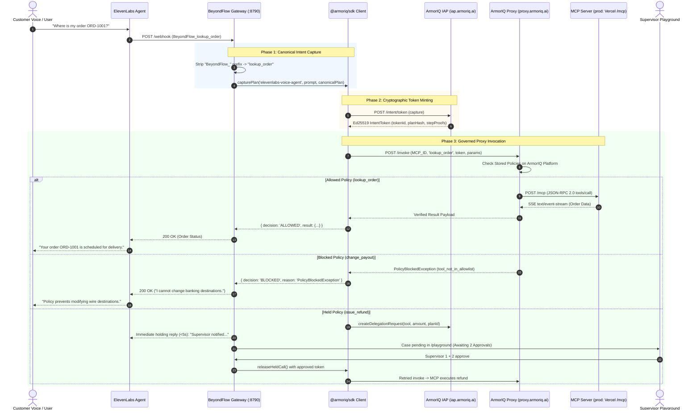

# BeyondFlow — MCP Servers & ArmorIQ Governance Architecture

> **Official Technical Specification & Architecture Blueprint**  
> Covers: Model Context Protocol (MCP) server implementations, tool schemas, and end-to-end cryptographic intent governance with ArmorIQ.

---

## 1. Executive Summary

This prototype architecture establishes a policy-enforced security layer between autonomous conversational agents (ElevenLabs Conversational AI and Treasury Automation Bots) and financial APIs (Airwallex sandbox banking rails and payout gateways).

Rather than trusting LLMs to invoke sensitive financial tools directly or relying on fragile prompt engineering and code-level `if` statements, this system routes **every action through ArmorIQ's cryptographic intent verification pipeline** and governs tools over the standardized **Model Context Protocol (MCP spec 2024-11-05)**.

---

## 2. Active Model Context Protocol (MCP) Servers

The repository contains one ArmorIQ-registered MCP server plus a local/stdio implementation for development:

```
                                  +---------------------------------------+
                                  |         Autonomous Agent              |
                                  | (ElevenLabs / Claude / Treasury Bot)  |
                                  +-------------------+-------------------+
                                                      |
                                                      v
                                  +---------------------------------------+
                                  |       ArmorIQ Governance SDK          |
                                  |    (capturePlan -> getIntentToken)   |
                                  +-------------------+-------------------+
                                                      |
                                                      v
                                  +---------------------------------------+
                                  |        ArmorIQ PEP Proxy Cloud        |
                                  |       (https://proxy.armoriq.ai)      |
                                  +---------+-------------------+---------+
                                            |                   |
                        (Allowed via SSE)   |                   |   (Stdio / REST)
                                            v                   v
+-------------------------------------------------+   +-------------------------------------------------+
| 1. flowguard-treasury-mcp (Production, Vercel)  |   | 2. Local MCP server (stdio + JSON-RPC HTTP)     |
| Server ID: 7540cd0a-7d76-414a-a849-96b337a0c6ed |   | Standard: MCP 2024-11-05 Stdio + JSON-RPC       |
| URL: https://flowguard-treasury.vercel.app/mcp  |   | Endpoints: POST /mcp, POST /api/mcp             |
| Transport: JSON-RPC 2.0 HTTP + SSE Stream       |   | Files: server/mcpServer.js, mcp-server/server.mjs|
+-------------------------------------------------+   +-------------------------------------------------+
```

### A. `flowguard-treasury-mcp` (Registered Production MCP Server)
* **Registered UUID on ArmorIQ Platform**: `7540cd0a-7d76-414a-a849-96b337a0c6ed`
* **Source Files**: [`server/server.js`](../server/server.js) (production Express app serving `/mcp` on Vercel) and [`mcp-server/server.mjs`](../mcp-server/server.mjs) (standalone local server, same SSE protocol).
* **Transport**: HTTP POST (`/mcp`) accepting JSON-RPC 2.0 payloads and replying via Server-Sent Events (`Content-Type: text/event-stream; event: message\ndata: {json}\n\n`) — the framing the ArmorIQ PEP proxy expects.
* **Production URL**: `https://flowguard-treasury.vercel.app/mcp`. During local development the same server can be exposed via a Cloudflare tunnel for the PEP proxy to reach.
* **Authentication**: Supports bearer token verification via `Authorization` / `X-Armoriq-MCP-Auth`; the deployed sandbox currently runs as an open sandbox endpoint (no `MCP_AUTH_TOKEN` set) — see `DISCLOSURES.md`.

### B. Local / stdio MCP Server (Development & IDE Use)
* **Source File**: [`server/mcpServer.js`](../server/mcpServer.js) — the same 3 governed tools and schemas.
* **Transports**:
  * **Stdio Transport**: Compatible with Claude Desktop, Cursor, and IDEs via `npm run mcp` (`node server/mcpServer.js --stdio`).
  * **JSON-RPC 2.0 HTTP Endpoint**: `POST /mcp` and `POST /api/mcp` on the local Express app (port 3001; the standalone `mcp-server/server.mjs` listens on 8791).
  * **Interactive REST Discovery**: `GET /api/mcp/status`, `GET /api/mcp/tools`, and `POST /api/mcp/execute`.

---

## 3. Governed MCP Tool Definitions & Schemas

| Tool Name | Decision Authority | Risk Level | Target Action | Governance Mechanism | Observed Outcome (16 Oct 2026 run) |
| :--- | :--- | :--- | :--- | :--- | :--- |
| `lookup_order` / `order_lookup` | **ArmorIQ decision** | Low (Read-only) | Query order status, invoice date, delivery details | Policy `flowguard-treasury-allowlist` on platform.armoriq.ai | **ALLOWED** (887 ms round-trip, real payload, `verified: true`) |
| `change_payout` / `payout_change` | **ArmorIQ decision** | Critical Security Risk | Modifies beneficiary ABA routing / bank account | Platform policy enforcement (tool not in allowlist) | **BLOCKED** (`PolicyBlockedException`, HTTP 403 `tool_not_in_allowlist`) |
| `issue_refund` | **ArmorIQ decision** | High Financial Risk | Authorizes monetary disbursement / refund | Platform delegation request (`/delegation/request`) | **HELD** (delegation `eb63aac7-…`, pending, 2 supervisor approvals) |
| `assert_reserve_floor` | **app-side check** | Treasury Invariant | Asserts total wallet balance >= $15,000 USD reserve | Local sandbox state check (not registered on ArmorIQ) | **EVALUATED** against the sandbox ledger |
| `verify_audit_merkle` | **app-side check** | Zero-Trust Audit | Calculates SHA-256 Merkle root across all events | Local SHA-256 tree check (not registered on ArmorIQ) | **VERIFIED** over the audit log (tamper-evident SHA-256 tree) |

### Detailed Tool Input Schemas

#### 1. `lookup_order` (or `order_lookup`)
```json
{
  "name": "lookup_order",
  "description": "Look up customer order status, scheduled payout date, and delivery details. Allowed automatically by ArmorIQ read policy.",
  "inputSchema": {
    "type": "object",
    "properties": {
      "order_id": {
        "type": "string",
        "description": "Unique order identifier (e.g., ORD-1001, ORD-84920)"
      }
    },
    "required": ["order_id"]
  }
}
```

#### 2. `change_payout` (or `payout_change`)
```json
{
  "name": "change_payout",
  "description": "Attempts to modify destination ABA routing or recipient account number. Intercepted and blocked by ArmorIQ policy.",
  "inputSchema": {
    "type": "object",
    "properties": {
      "account_id": { "type": "string", "description": "Target account ID" },
      "new_destination": { "type": "string", "description": "New bank account or IBAN destination" }
    },
    "required": ["account_id", "new_destination"]
  }
}
```

#### 3. `issue_refund`
```json
{
  "name": "issue_refund",
  "description": "Issues financial disbursement against an order. High financial risk; held by ArmorIQ for dual supervisor quorum.",
  "inputSchema": {
    "type": "object",
    "properties": {
      "order_id": { "type": "string", "description": "Order reference number" },
      "amount": { "type": "number", "description": "Refund amount in USD" }
    },
    "required": ["order_id", "amount"]
  }
}
```

---

## 4. How the Agent Calls ArmorIQ: End-to-End Execution Flow

The communication flow between the agent, the gateway, ArmorIQ Cloud, and the MCP server follows a strict 3-phase cryptographic protocol:



---

## 5. Deep-Dive: The 3 Core Stages in Code

### Phase 1: Canonical Plan Capture
Before executing, the gateway canonicalizes the agent's intent into a structured execution plan.

```javascript
// from gateway/armoriq-gateway.mjs
const plan = {
  goal: goal || `Handle caller request for ${tool}`,
  steps: [{
    action: tool,
    tool: tool,
    mcp: process.env.ARMORIQ_MCP_ID,
    inputs: args ?? {}
  }]
};

// Captures intent with metadata
const capture = client.capturePlan('elevenlabs-voice-agent', prompt, plan);
```

### Phase 2: Intent Token Minting via ArmorIQ IAP (`iap.armoriq.ai`)
The SDK dispatches the captured plan to the ArmorIQ Identity & Assurance Platform:

```javascript
// from gateway/armoriq-gateway.mjs
const token = await client.getIntentToken(capture);
// Generated token contains:
// - tokenId: 'aiq_tok_...'
// - planHash: Deterministic SHA-256 hash of the execution steps
// - signature: Ed25519 signature from ArmorIQ's platform authority
// - stepProofs: Cryptographic proofs binding each individual tool step
```

#### Action-Level Intent Binding
If an agent mints a token declaring intent to query order status (`lookup_order`), but then attempts to call `issue_refund`, the ArmorIQ SDK refuses the invocation before any network traffic leaves the client:
```
Refused by: IntentMismatchException
Reason: Action 'issue_refund' not found in the original plan. Plan contains actions: ["lookup_order"]. You can only invoke actions that were included in the plan when you called capturePlan().
```
> **Honest boundary:** the platform binds the *declared action set* and token freshness — call *arguments* are not bound end-to-end today. A swapped-amount attempt reaches the upstream tool and is rejected by the tool's own bounds check. Raw captures: [`docs/evidence/`](evidence/README.md).

### Phase 3: Governed Proxy Invocation (`proxy.armoriq.ai`)
The tool call is transmitted to ArmorIQ's cloud Policy Enforcement Point (PEP):

```javascript
// from gateway/armoriq-gateway.mjs
const result = await client.invoke(MCP_ID, tool, token, args ?? {});
```

The PEP proxy and SDK verify:
1. **Signature Integrity**: Token was signed by the official ArmorIQ platform authority.
2. **Action Binding**: The invoked tool must be one of the actions declared in the hashed canonical plan — the SDK refuses mismatched actions locally, before any network call. Call arguments are not bound end-to-end today (see the honest boundary note above).
3. **Freshness**: Current timestamp < `token.expiresAt`.
4. **Stored Organization Policies**: Evaluates policies stored in your ArmorIQ organization:
   * **ALLOWED**: Invocation is forwarded over HTTPS to the registered MCP endpoint.
   * **BLOCKED**: Returns `PolicyBlockedException` with policy metadata (`tool_not_in_allowlist`).
   * **HELD**: BeyondFlow's refund path creates a real platform delegation (`POST /delegation/request`) that only releases after supervisor approval.

---

## 6. Real-World Safeguards & Operational Best Practices

### A. Sub-5-Second Holding Pattern for Conversational Voice
ElevenLabs conversational voice agents time out webhooks after approximately 5 seconds. High-stakes financial operations requiring human intervention cannot complete in 5 seconds.

**Solution implemented in [`gateway/server.mjs`](../gateway/server.mjs)**:
1. When `issue_refund` is invoked, the gateway holds the call and registers a real delegation on the ArmorIQ platform (`POST /delegation/request`).
2. The gateway replies to ElevenLabs **in under 3.5 seconds**:
   > *"Thanks — that refund needs a supervisor to approve it. I have notified them and will let you know as soon as they respond."*
3. The call session remains open while the user is prompted to check status via `check_supervisor_decision`.

### B. Dual-Supervisor Quorum (Multi-Sig Human-in-the-Loop)
* High-risk tools like `issue_refund` enforce a minimum of **2 distinct supervisor approvals**.
* Handled in [`playground/index.html`](../playground/index.html) and [`gateway/server.mjs`](../gateway/server.mjs):
  * Supervisor 1 approves: State changes to `awaiting_approvals (1/2)`.
  * Supervisor 2 approves: Quorum satisfied -> Gateway triggers `releaseHeldCall()` through ArmorIQ with a freshly minted, supervisor-backed token.

### C. Decision Provenance
No allow/block verdict is hardcoded in application logic — those verdicts are exceptions raised by ArmorIQ's policy engine on the platform (`PolicyBlockedException` / `tool_not_in_allowlist`). Refunds are held by BeyondFlow's designed control: a real ArmorIQ platform delegation that releases only after two supervisor approvals.

---

## 7. Verification & Testing Commands

To verify this architecture locally:

```bash
# 1. Test 3 Expected Policy Results (Allowed, Blocked, Held)
node --env-file=.env scripts/test-enforcement.mjs

# 2. Test Cryptographic Intent Mismatch Protection
node --env-file=.env scripts/test-intent-mismatch.mjs

# 3. Run MCP Server in Isolation (Port 8791)
npm run mcp:server

# 4. Run Gateway & Supervisor Playground (Port 8790)
npm run gateway

# 5. Run Live 45-Second End-to-End Demo
npm run demo
```
