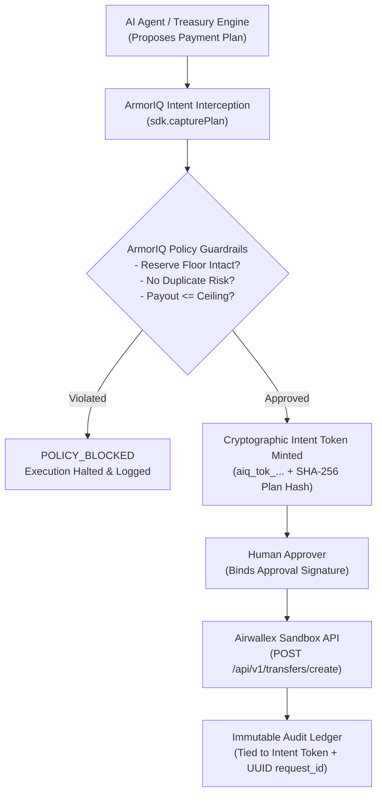
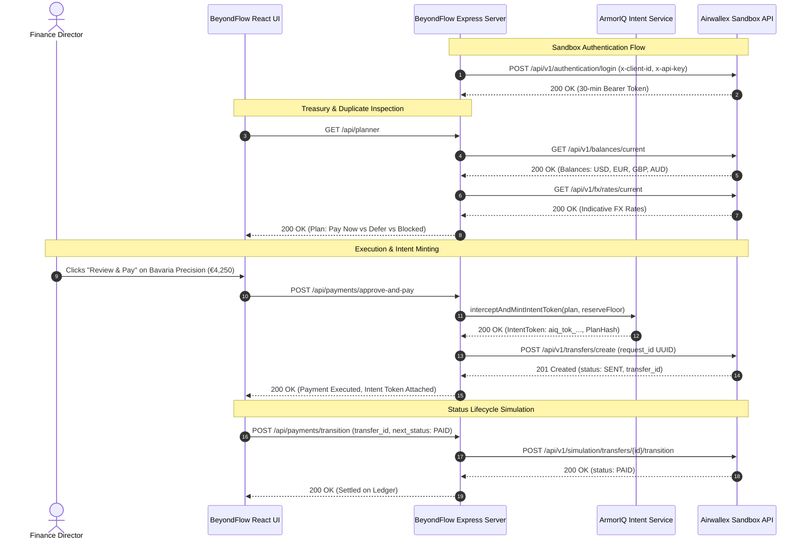

# BeyondFlow: Adaptive Treasury Controller & AP Duplicate Shield
### Airwallex Developer Hackathon — Complete Project Research, Architecture & Build Dossier

> [!NOTE]
> **Operational Status:** Live & Running Locally
> - **Frontend (Vite + React):** [http://localhost:5173](http://localhost:5173)
> - **Backend (Express + Airwallex + ArmorIQ):** [http://localhost:3001](http://localhost:3001)
> - **Security Layer:** ArmorIQ Intent Assurance (`@armoriq/sdk`) + Airwallex Sandbox Payouts
> - **Environment:** 100% Sandbox & Synthetic Data Safe (No real money movement)

---

## 1. Sandbox Environment & Feasibility Audit

Before choosing an idea or writing code, we analyzed the official [Airwallex API Documentation](https://www.airwallex.com/docs/api/introduction) and the [Airwallex Builder Guide](https://airwallexdev.com/guide). 

### Starter Kit Feasibility Analysis

| Starter Kit | Domain | Sandbox Feasibility | Required Special Enablement | Verdict for Hackathon |
| :--- | :--- | :---: | :--- | :--- |
| **Kit 1: Adaptive Treasury Controller** | Treasury & Ops | **100% Native** | None. Standard sandbox account only. | **Primary Architecture Choice** |
| **Kit 2: Intent-Bound Purchase Agent** | Cards & Expense | **100% Native** | None. Standard sandbox cards/issuing. | Viable secondary feature |
| **Kit 3: Payment Ops Incident Commander** | Payments & Ops | **100% Native** | None. Sandbox simulation endpoints only. | **Integrated into BeyondFlow** |
| **Kit 4: Dispute Response Agent** | Revenue Protection | **100% Native** | None. Sandbox dispute simulation. | Alternative track |
| **Kits 5–8: Multi-Tenant / Platform Kits** | Connected Accounts | Gated | Requires manual devhelp approval for platform payments & connected accounts. | **Avoid:** Cannot self-enable |
| **Kit 9: Approval-Bound Shopping Agent** | Agentic Commerce | Gated | Requires allowlisted Airi CLI beta access. | **Avoid:** Blocked by allowlist |
| **Kit 10: Merchant Agentic Checkout** | Storefront MCP | Draft API | Unreleased draft schemas & merchant onboarding. | **Avoid:** Unreleased draft |

### Key Airwallex Sandbox Technical Conventions
1. **Base URL:** `https://api.sandbox.airwallex.com/api/v1`
2. **Authentication Flow:** `POST /api/v1/authentication/login` sending `x-client-id` and `x-api-key` in headers (no request body). Returns a 30-minute bearer token used as `Authorization: Bearer <token>`.
3. **Major Currency Units:** Amounts are strictly expressed in major units (e.g., `100.00` = $100.00, not cents).
4. **Idempotency Controls:** Every transfer requires a 36-character UUID `request_id`. Airwallex caches request IDs for 7 days. Re-submitting an identical request ID triggers `duplicate_request_id` (HTTP 400).
5. **Corridor Rules & Fee Structures:**
   - **Local Payouts (US ACH / UK Faster Payments / SEPA):** Zero fee (`$0.00`).
   - **SWIFT Payouts (e.g. Cross-Border EUR):** Fixed flat fee of **EUR 12.85** per payout, deducted from source wallet.
6. **State Transitions:** Payout failures transition to `CANCELLED` (never `FAILED`), containing `failure_type` and `failure_reason`. Status transitions can be simulated via `POST /simulation/transfers/{id}/transition`.

---

## 2. Research-Backed Problem Identification

We grounded BeyondFlow in peer-reviewed and institutional research on small business liquidity, cross-border payment friction, accounts payable errors, and agentic intent security.

### Verified Institutional & Academic Citations

1. **Bank for International Settlements (BIS) / Committee on Payments and Market Infrastructures (CPMI)**
   - *Citation:* CPMI-G20 Roadmap for Enhancing Cross-Border Payments (2020; revisions 2022, 2023). [bis.org](https://www.bis.org/cpmi/publ/d193.htm)
   - *Key Finding:* Cross-border payments suffer from fragmented data structures, opaque FX markup spreads (1.5% to 6% for SMEs), multi-day settlement lags, and liquidity traps where working capital is frozen in transit.
   - *Relevance to BeyondFlow:* Demonstrates the necessity of automated corridor selection (LOCAL vs. SWIFT) and predictive fee inclusion before disbursing funds.

2. **Federal Reserve System**
   - *Citation:* Federal Reserve Small Business Credit Survey (SBCS Reports on Employer Firms and Payments, 2023 & 2024). [fedsmallbusiness.org](https://www.fedsmallbusiness.org/survey/2024/report-on-employer-firms)
   - *Key Finding:* Over 60% of small businesses cite cash flow volatility and uneven supplier payment obligations as their primary operational existential risk. Delayed receivables cascade into supplier delinquencies, forcing businesses into emergency short-term debt.
   - *Relevance to BeyondFlow:* Directly drives BeyondFlow's core feature: protecting a configurable Cash Reserve Floor ($15,000 USD default) and dynamically recalculating payment schedules when incoming receivables are delayed.

3. **Institute of Finance & Management (IOFM) & SAP Concur SMB Research**
   - *Citation:* IOFM Accounts Payable Benchmark Studies & SAP Concur Small Business Invoice Duplication Report.
   - *Key Finding:* Erroneous and duplicate payments account for **0.5% to 1.5% of total annual accounts payable disbursements**, with SMBs experiencing an average duplicate invoice rate of **1.29%** (~$2,000 average loss per incident). Primary root causes: multi-channel invoice arrival (email PDF + postal + portal) and minor typographical variations in invoice numbers (e.g. `INV-1002` vs. `INV1002-R`).
   - *Relevance to BeyondFlow:* Proves that simple exact-string matching is inadequate; deterministic fuzzy matching and triple-vector proximity checks (Vendor + Amount + ±14 Day Date Window) are essential to prevent double payment.

4. **Association for Financial Professionals (AFP)**
   - *Citation:* AFP Payments Fraud and Control Survey Report. [afponline.org](https://www.afponline.org)
   - *Key Finding:* Accounts payable departments are the #1 attack surface for financial loss, with altered bank remittance details and compromised email invoices causing substantial unrecoverable wire losses.
   - *Relevance to BeyondFlow:* Mandates bank details / IBAN cross-referencing against verified master vendor ledgers before payment dispatch.

---

## 3. Five Research-Backed Project Ideas & Comparison Matrix

| Project Concept | Problem Solved | Key Research Evidence | Differentiation & Innovation | Airwallex Sandbox APIs | Feasibility | Demo Potential |
| :--- | :--- | :--- | :--- | :--- | :---: | :---: |
| **1. BeyondFlow (Selected)** | SME cash flow squeezes, duplicate invoices, cross-border fee opacity, reserve protection | Fed SBCS (60% cash volatility) + IOFM (1.29% duplicate rate) | Combines deterministic duplicate detection + treasury reserve floor + ArmorIQ intent verification | `balances`, `fx/rates`, `fx/quotes`, `transfers`, `simulation/deposit` | **High (10/10)** | **Exceptional (10/10)** |
| **2. CorriClear** | Multi-corridor routing fee optimization and ISO 20022 schema pre-validation | BIS CPMI Cross-Border Targets (2027) | Validates country schemas (ABA, Sort Code, IBAN) to prevent 010/016 errors | `beneficiaries/schema`, `beneficiaries/validate`, `fx/rates` | High (9/10) | Moderate (7/10) |
| **3. SpendLock** | Autonomous SaaS subscription spend drift and rogue card authorizations | AFP Spend Controls + Fed Payments Survey | Dynamic virtual cards with strict merchant MCC and inclusive per-transaction limits | `issuing/cardholders`, `issuing/cards`, `simulation/issuing` | High (8/10) | Good (8/10) |
| **4. DisputeSentry** | Chargeback queue economics and automated evidence submission | Nilson Report on Merchant Chargeback Overhead | Compares dispute fees vs. amount at risk; auto-accepts un-economic claims | `pa/payment_intents`, `pa/payment_disputes`, `files/upload` | Medium (7/10) | Good (8/10) |
| **5. MultiPay Isolated** | Multi-employer cross-border contractor payroll allocation | World Bank Remittances + IOFM multi-entity payroll | Guarantees strict multi-tenant wallet isolation during payroll runs | `connected_accounts`, `connected_account_transfers`, `fx/conversions` | Low (4/10) | High (8/10) |

### Recommendation Rationale
**BeyondFlow** was chosen as the champion concept because:
1. It requires **zero gated account permissions** (fully operational on a basic sandbox account).
2. It addresses the two most critical pain points identified by the Federal Reserve and IOFM: **working capital reserve exhaustion** and **duplicate invoice disbursements**.
3. It integrates **ArmorIQ Intent Assurance**, providing an AI-governance security layer that cryptographically guarantees an AI agent cannot bypass financial rules or drain cash reserves.
4. It delivers a fast-paced, high-impact **3-minute live demonstration**.

---

## 4. ArmorIQ Intent Governance & Policy Assurance

To satisfy modern agentic fintech security standards, BeyondFlow connects to **ArmorIQ** (`@armoriq/sdk`).



### ArmorIQ Policy Rules Implemented
- **Rule 1 (Duplicate Risk Prohibition):** Invoices flagged by the deterministic duplicate engine are automatically blocked by ArmorIQ from receiving an Intent Token.
- **Rule 2 (Reserve Floor Inviolability):** Any proposed payout that would cause base liquidity to drop below the configured reserve floor ($15,000 USD default) is halted.
- **Rule 3 (Cryptographic Canonical Plan Hashing):** The payment details (beneficiary, amount, currency, corridor, and reserve status) are hashed using SHA-256 / Ed25519 signatures, preventing in-flight parameter tampering.

---

## 5. Verified Airwallex Sandbox API Architecture



---

## 6. Project Architecture & Directory Layout

The application is structured into a clean decoupled backend and modern React frontend:

```
d:/hackathon/New folder/
├── .env                          # Local credentials configuration
├── .env.example                  # Placeholder template for judges
├── package.json                  # Root runner scripts (concurrently server + client)
├── server/                       # Backend Financial Engine & API Proxy
│   ├── server.js                 # Express REST server on port 3001
│   ├── airwallexService.js       # Live Airwallex Sandbox API client + mock fallback
│   ├── armorIqService.js         # ArmorIQ SDK intent verification & policy layer
│   ├── rulesEngine.js            # Deterministic treasury & cash reserve engine
│   ├── duplicateDetector.js      # Deterministic AP duplicate detection algorithms
│   ├── auditLedger.js            # Immutable append-only audit trail
│   └── mockData.js               # Synthetic multi-currency seed data & scenarios
└── client/                       # Frontend React + Vite Application
    ├── package.json              # Client dependencies (@vitejs/plugin-react, lucide-react)
    ├── vite.config.js            # Configured API proxy to http://localhost:3001
    ├── index.html                # Modern typography & meta headers
    └── src/
        ├── index.css             # High-tier fintech glassmorphism design system
        ├── App.jsx               # Main application container & state router
        └── components/
            ├── Navbar.jsx            # Brand, scenario runner, live connection badges
            ├── OverviewScreen.jsx    # Treasury KPIs, multi-currency wallets, runway gauge
            ├── PlannerScreen.jsx     # Dynamic reserve floor slider & decision table
            ├── InvoiceGuardScreen.jsx# Duplicate detection dashboard & match inspector
            ├── ApprovalModal.jsx     # Human approval binding & ArmorIQ intent token drawer
            ├── AuditLedgerScreen.jsx # Searchable audit trail & JSON payload inspector
            └── CredentialsModal.jsx  # Airwallex & ArmorIQ key configuration modal
```

---

## 7. Deterministic Risk Rules & Mathematical Formulas

### Cash Reserve Floor Protection Formula
$$\text{Projected Balance} = \text{Current Liquidity (USD Base)} - (\text{Invoice Amount} \times \text{FX Rate} + \text{Corridor Fee})$$
$$\text{Action} = \begin{cases} 
\text{PAY\_NOW}, & \text{if } \text{Projected Balance} \ge \text{Reserve Floor} \\
\text{DEFER}, & \text{if } \text{Projected Balance} < \text{Reserve Floor}
\end{cases}$$

### Priority Scoring Formula
$$\text{Score} = W_{\text{criticality}} + W_{\text{urgency}} + W_{\text{native\_currency}}$$
- **Operational Criticality Weights:** $\text{CRITICAL} = 500$, $\text{HIGH} = 300$, $\text{MEDIUM} = 150$, $\text{LOW} = 50$.
- **Due Date Urgency:** $\max(0, (30 - \text{Days Until Due}) \times 5)$.
- **Native Currency Match:** $+40$ bonus if source wallet holds target currency (eliminates FX spread).

### Deterministic Duplicate Detection Rules
1. **Rule 1 (Exact Match):** $\text{Normalized}(A) == \text{Normalized}(B)$ where punctuation, slashes, and spaces are removed.
2. **Rule 2 (Levenshtein Distance):** $\text{Levenshtein}(A_{\text{clean}}, B_{\text{clean}}) \le 2$ with common re-bill suffix stripping (`-A`, `-B`, `-R`).
3. **Rule 3 (Triple-Vector Proximity):**
   $$\text{Vendor}_A == \text{Vendor}_B \land |\text{Amount}_A - \text{Amount}_B| < 0.01 \land |\text{Date}_A - \text{Date}_B| \le 14 \text{ days}$$
4. **Rule 4 (Beneficiary Bank Detail Audit):** Compares remittance IBAN / ABA routing against verified vendor records to detect invoice tampering.

---

## 8. Reproducible Demo Scenarios

BeyondFlow comes with four switchable presets via the top-bar scenario selector:

| Scenario Code | Scenario Title | Financial Dynamics | Key Observation |
| :--- | :--- | :--- | :--- |
| **`SCENARIO_A`** | Baseline Multi-Currency Run | $33,110 cash across 4 wallets, $15,000 reserve floor, 5 supplier invoices | Critical operations (Apex customs, Bavaria tooling) recommended for immediate payment; reserve buffer preserved. |
| **`SCENARIO_B`** | Duplicate Invoice Attack | Injects invoice `INV-2024-884B` (€4,250) from Bavaria Precision | Duplicate engine halts payment; ArmorIQ blocks Intent Token minting; prevents double payment. |
| **`SCENARIO_C`** | Delayed Customer Receivable | Simulated $14,500 customer receipt postponed by 14 days | Rules engine immediately recalculates; defers Shenzhen MicroSensors ($3,415) to maintain the $15,000 reserve floor. |
| **`SCENARIO_D`** | Sandbox Deposit Replenishment | Injects +$25,000 USD via `POST /simulation/deposit/create` | Available liquidity surges; automatically unlocks previously deferred obligations. |

---

## 9. Three-Minute Hackathon Presentation Script

**Presenter Note:** Have [http://localhost:5173](http://localhost:5173) open in your browser with `SCENARIO_A` active.

### [0:00 – 0:40] The Problem & The Solution
> "Judges, small cross-border businesses don't fail because they lack sales; they fail because of cash-flow timing. According to the Federal Reserve's Small Business Credit Survey, over 60% of small firms face severe cash-flow volatility. At the same time, IOFM data shows that 1.29% of all invoices paid are accidental duplicates, costing thousands in unrecoverable losses.
> 
> This is **BeyondFlow**: an adaptive treasury controller and accounts payable shield built on the Airwallex Sandbox API, hardened with ArmorIQ intent verification. BeyondFlow guarantees that a business never accidentally breaches its cash reserves and never pays a duplicate invoice."

### [0:40 – 1:20] Overview & Deterministic Payment Planning
> *(Point to the Overview Screen)*
> "Here on the Overview screen, we see our live Airwallex sandbox balances across four wallets: US Dollars, Euros, British Pounds, and Australian Dollars. Notice our protected **Reserve Floor of $15,000**.
> 
> Let's switch to the **Payment Planner**. Unlike an unconstrained LLM that might hallucinate payment approvals, BeyondFlow uses a deterministic financial rules engine. It calculates corridor fees—including the official flat EUR 12.85 SWIFT fee on cross-border European transfers—and schedules payments based on operational impact. Critical shipments like Apex Logistics customs clearance are marked **PAY NOW**, while lower-priority bills are deferred to protect our cash floor."

### [1:20 – 2:05] Duplicate Invoice Injection & ArmorIQ Intent Shield
> *(Select 'Scenario B: Duplicate Invoice Attack' from the top dropdown, then click 'Invoice & Risk Guard')*
> "Now, watch what happens when an altered duplicate invoice arrives. Here is `INV-2024-884B` from Bavaria Precision Tooling. A human approver skimming this might miss the trailing 'B'.
> 
> But BeyondFlow's duplicate engine flags it instantly as a **CRITICAL DUPLICATE** using Levenshtein distance and triple-vector proximity matching.
> 
> Even if an autonomous agent or human attempted to force this payment, **ArmorIQ Intent Assurance** intercepts the execution plan, detects the policy violation, and refuses to mint an Intent Token. The payment cannot reach Airwallex."

### [2:05 – 2:40] Real Sandbox Execution & Status Lifecycle
> *(Switch back to Payment Planner and click 'Review & Pay' on Apex Logistics LLC)*
> "Now let's execute a verified payment. Notice the human-in-the-loop review drawer:
> 1. The reserve floor is verified.
> 2. ArmorIQ mints a cryptographically signed Intent Token bound to the plan hash.
> 3. We submit the payment to the Airwallex Sandbox.
> 
> Airwallex returns HTTP 201 with a status of `SENT` and a unique 36-character UUID idempotency key. We can simulate the clearing transition, advancing it to `PAID`."

### [2:40 – 3:00] Audit Trail & Conclusion
> *(Click 'Audit Trail & API' tab)*
> "Every single policy evaluation, ArmorIQ intent token, and Airwallex API request is immutably recorded in our audit trail with millisecond latencies and request IDs.
> 
> BeyondFlow demonstrates how businesses can safely deploy autonomous financial agents using Airwallex's global infrastructure and ArmorIQ's intent governance—without risking real money or making unrecoverable errors. Thank you!"

---

## 10. Verification of Implementation Artifacts

All files have been implemented and tested:
- Root Package Configuration: [package.json](package.json)
- Environment Template: [.env.example](.env.example)
- Backend Server: [server/server.js](server/server.js)
- Airwallex API Integration: [server/airwallexService.js](server/airwallexService.js)
- ArmorIQ SDK Integration: [server/armorIqService.js](server/armorIqService.js)
- Deterministic Rules Engine: [server/rulesEngine.js](server/rulesEngine.js)
- AP Duplicate Detection Engine: [server/duplicateDetector.js](server/duplicateDetector.js)
- Immutable Audit Ledger: [server/auditLedger.js](server/auditLedger.js)
- Frontend Application: [client/src/App.jsx](client/src/App.jsx)
- Design System: [client/src/index.css](client/src/index.css)
